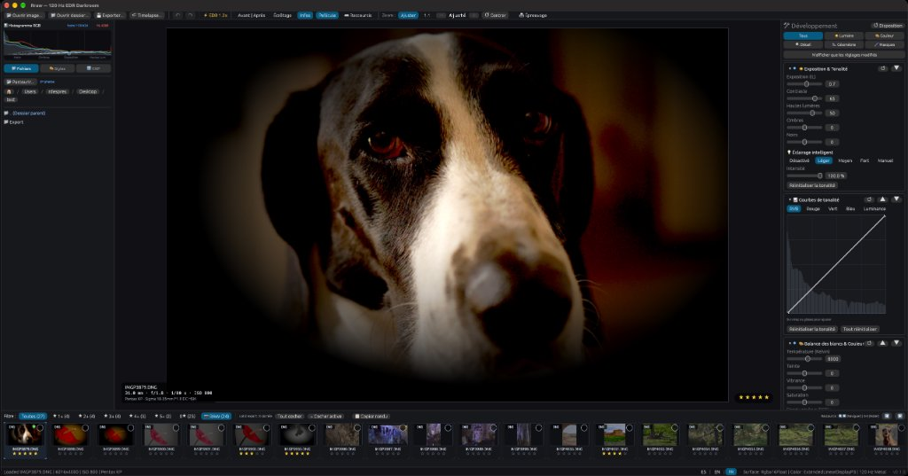

# Rraw

**Rraw** is a high-performance, native macOS (Apple Silicon M-series) photographic RAW development workstation engineered in Rust. It combines a catalog-free filesystem browser, a mathematically grounded 7-stage GPU pipeline (`wgpu` / Metal), dual wavelet and neural sensor-noise reduction, regularized Richardson-Lucy optical deconvolution, dual-illuminant spectral colorimetry in `ACEScg` (`AP1` D60), and 120 Hz ProMotion Extended Dynamic Range (EDR) display rendering.

<p align="center">
  
</p>

---

## Key Capabilities & Features

### 1. RAW Sensor & Camera Decoding
- **Bayer & Fujifilm X-Trans**: Pure-Rust decoding powered by `rawler` and dedicated TIFF/ISOBMFF parsers, supporting modern Bayer sensors (Sony, Nikon, Canon, Leica, Panasonic) as well as $6 \times 6$ Fujifilm X-Trans CFA patterns.
- **Signed Sensor Normalization**: Preserves negative read-noise samples below black level ($< 0.0$) in `R32Float` representation to maintain unbiased noise statistics.
- **Defect & Artifact Mitigation**: Pre-demosaic repair of hot pixels, PDAF focus-pixel lines, and sensor phase artifacts.
- **Chromatic-Ratio Highlight Reconstruction**: Reconstructs saturated highlight channels using unclipped channel ratios to prevent hue shifts (e.g., magenta highlights).

### 2. Dual Denoising Engine
- **Real-Time GPU Wavelets (120 Hz)**: Generalized Anscombe Variance-Stabilizing Transform (GAT) coupled with multi-scale À-Trous wavelets on GPU, calibrated directly to the sensor's Poisson-Gaussian noise profile.
- **High-Fidelity Neural Denoising (Apple Neural Engine)**: Offline inference via CoreML / `ort` executed directly on the Apple Neural Engine (ANE). Uses a phase-preserving $504 \times 504$ tiling strategy with $48\text{ px}$ $\cos^2$ overlap blending to eliminate tile-boundary seams.

### 3. 4-Tier Optical Correction & Capture Sharpening
- **Hierarchical Optical Resolver**: Automatically resolves geometric distortion, lateral chromatic aberration (CA), and vignetting through a 4-tier fallback:
  1. *Tier 1*: Embedded camera MakerNotes and DNG opcodes (Sony, Nikon, Fuji, Micro 4/3, Canon).
  2. *Tier 2*: Open-source `Lensfun` database (`PTLens`, `Poly3`, `Poly5` models).
  3. *Tier 3*: Local Adobe Lens Profile (`.lcp`) files (`Brown-Conrady`).
  4. *Tier 4*: Manual parametric adjustment.
- **Fused GPU WARP Shader**: High-precision Catmull-Rom bicubic sampling with fused radial vignetting and lateral CA correction in a single GPU pass.
- **Regularized Richardson-Lucy Deconvolution**: Recovers optical diffraction and lens softness using a radial Point Spread Function (PSF) and a noise-adaptive edge mask ($M_{\text{edge}}$) that prevents noise amplification in smooth areas.

### 4. Cinematic Color Science & Native EDR
- **`ACEScg` Working Space**: 100% linear floating-point processing in the Academy Color Encoding System (`ACEScg` / `AP1` D60).
- **Dual-Illuminant Spectral Calibration**: Continuous mired interpolation between D50 and D65 calibration illuminants, Bradford chromatic adaptation, and an identity-core Gamut Guard.
- **Modern Tone Mapping**: `AgX` and `OpenDRT` transforms parameterizing highlight rolloff based on real-time display capabilities.
- **Native Liquid Retina XDR / Pro Display XDR (up to 1600 nits)**: Direct zero-copy composition on `CAMetalLayer` in `extendedLinearDisplayP3` (`Rgba16Float`), rendering true specular highlights without premature SDR tone compression.
- **Color Management & Soft Proofing (ICC)**: Real-time display and print profile simulation (*sRGB IEC61966-2.1*, *Apple Display P3*, *Adobe RGB 1998*, *Fine Art Matte Cotton Paper*, *Glossy Baryta Photo Paper*) with *Perceptual* and *Relative Colorimetric* rendering intents, paper white & black ink (`Dmin`/`Dmax`) reflectance simulation, and high-contrast magenta/cyan out-of-gamut warning zebras.
- **Real-Time GPU Diagnostic Scopes**: Workgroup-reduced GPU histogram, RGB parade, out-of-gamut pixel counter, and real-time clipping zebra overlays (SDR clipping $> 1.0$ and live EDR headroom clipping $> H_{\text{active}}$).

### 5. Local Adjustments, Parametric & CoreML AI Semantic Masking
- **Geometric Masks**: Normalized $[0, 1]^2$ linear and radial gradients computed post-warp.
- **Parametric Masks**: High-precision Luminance, Chroma, and Hue masks evaluated at 120 Hz in `ACEScg` color space directly on GPU.
- **CoreML AI Semantic Segmentation Masks**: Four-class semantic segmentation (`Subject`, `Sky`, `Background`, `Portrait`) with edge-preserving bilateral guided refinement, bilinear WGSL Stage 6 GPU evaluation, smooth feathering, mask inversion, live ruby-magenta viewport overlay, and per-layer local Exposure, Contrast, Saturation, and Temperature grading.

### 6. Catalog-Free Workflow & Non-Destructive Sidecars
- **Direct Filesystem Operation**: No proprietary, monolithic catalog databases that risk corruption or lock-in.
- **Asynchronous SQLite Cache**: Ultra-fast background indexing of metadata (`PhotoMetadata`), EXIF, and thumbnail mipmaps for instantaneous folder navigation.
- **Dual Sidecar Architecture**:
  - Deterministic `.rraw.json` recipe DAG recording all adjustment parameters.
  - Lossless, non-destructive `.xmp` sidecar synchronization, strictly preserving third-party namespaces (e.g. Adobe Lightroom, Darktable).

### 7. Next-Generation HDR Batch & Timelapse Export
- **Multi-Threaded Queue**: Asynchronous background export preserving full bit depth.
- **Supported Formats**: 16-bit TIFF, 16-bit PNG, full-quality JPEG, AVIF (pure-Rust `rav1e`), and JPEG XL (`libjxl`).
- **ISO 21496-1 HDR Gain Maps**: Embeds standardized gain maps into AVIF, JPEG XL, and JPEG files, providing universal backward compatibility on standard SDR displays while unlocking full HDR luminance on supported devices.
- **RAW Timelapse & Temporal Deflicker Engine**: High-bit-depth numbered sequence assembly (`<prefix>_00001.<ext>`), weighted local-linear temporal log2 luminance deflickering (`ΔEV`) eliminating mechanical aperture jitter, Holy Grail day-to-night keyframe ramping (interpolating Exposure, Kelvin, Tint, Contrast, and Saturation), and `timelapse_sequence.json` manifest generation with ready-to-run FFmpeg ProRes 422 HQ / 10-bit HEVC assembly commands.

### 8. Full Internationalization (i18n) & Desktop Ergonomics
- **Zero-Allocation i18n Engine**: 100% typed string tables with compile-time exhaustiveness matching (`Language { Fr, En }`), zero runtime allocations (`&'static str`), and instant reactive live switching without app restart.
- **Persistent User Preferences**: Compact `FR | EN` top bar toggle, backward-compatible layout persistence (`~/.config/rraw/layout.json`), and comprehensive French / English localization across all panels, tools, EXIF metadata, and shortcuts.

---

## Architecture & Engineering Rigor

- **Pure-Rust Parsing & Business Logic**: All TIFF/ISOBMFF, DNG `OpcodeList`, MakerNotes, Lensfun XML, and Adobe `.lcp` parsing are implemented in safe Rust (`#![forbid(unsafe_code)]`), eliminating attack surfaces from legacy C/C++ libraries.
- **Strict `unsafe` Isolation (`E0453` Compliant)**: 10 out of 12 workspace crates enforce `#![forbid(unsafe_code)]`. Only `rraw-macos-edr` and `rraw-coreml` use `#![deny(unsafe_code)]` with minimal, audited, `// SAFETY:`-documented `#[allow(unsafe_code)]` blocks bridging macOS platform subsystems (`AppKit`/`QuartzCore` display headroom and CoreML/ANE neural execution) behind safe traits.
- **Zero-Crash Policy**: Workspace-wide Clippy lints forbid `.unwrap()`, `.expect()`, `panic!()`, `todo!()`, and `unimplemented!()` in all production and test code.
- **Mathematically Grounded TDD**: Every processing stage is verified with deterministic synthetic fixtures (Poisson-Gaussian noise, Siemens stars, analytic PSF blur, synthetic D50/D65 ColorChecker patches) and headless GPU testing (`GpuContext::new_headless()`).

---

## 7-Stage GPU Pipeline Summary

1. **Stage 1 — Signed Sensor Pre-Processing (`Cache L0`, `R32Float`)**: Signed black/white normalization preserving negative read-noise samples ($< 0.0$), `NoiseProfile` extraction (`0xc761` + wavelet MAD fallback), DNG `GainMap` application (`vignette_handled_by_gainmap`), hot-pixel/PDAF defect repair, pre-demosaic `clip_mask`, and dual denoising (120 Hz À-Trous Anscombe GPU wavelets or asynchronous CoreML `504×504` tiled ANE inference).
2. **Stage 2 — Pre-Demosaic White Balance, Demosaicing & Highlight Reconstruction**: Pre-demosaic channel multipliers $\mathbf{w}$ without clamping at `1.0`, tracking physical channel ceilings $\text{sat}_c = 1.0 \times w_c$; RCD (Bayer) / Markesteijn (X-Trans) demosaicing; and chromatic-ratio Highlight Reconstruction (`HLR`) above $\min_c(\text{sat}_c)$ using `clip_mask`.
3. **Stage 3 — Regularized Capture Sharpening (`Cache L1`, `Rgba16Float` + Mipmaps)**: Positive-clamped input ($I^{(0)} = \max(I_{\text{HLR}}, 0.0)$) into damped Richardson-Lucy deconvolution ($\epsilon = 10^{-6}$, `NoiseProfile`-indexed edge mask $M_{\text{edge}}$, radial PSF, local overshoot deringing) and anti-aliased mipmap pyramid ($L \in \{0, 1, 2\}$).
4. **Stage 4 — Fused Optical Warp & Vignetting (`Cache L2`, $256 \times 256$ `Rg32Float` UV LUTs)**: 4-tier optical resolver (embedded RAW/DNG opcodes/MakerNotes -> Lensfun XML -> local `.lcp` -> manual), Catmull-Rom bicubic warp with fused radial vignetting (skipped when `vignette_handled_by_gainmap == true`), and `max(rgb, 0.0)` output clamp.
5. **Stage 5 — DNG Colorimetry & Grading (`ACEScg` `AP1` D60 Linear)**: Iterative CCT solver with 1D mired interpolation, strict separation of `ForwardMatrix1/2` vs `ColorMatrix1/2` (`(AB·CC·CM)^-1`) -> Bradford adaptation -> `ACEScg`, identity-core Gamut Guard, exposure, scale-invariant Laplacian local contrast ($N_{\text{effective}} = N_{\text{octaves}} - L$), and post-warp normalized `[0, 1]²` local masks.
6. **Stage 6 — Display Rendering Transform (DRT)**: `AgX` / `OpenDRT` parameterized by live display headroom $H_{\text{active}} \in [1.0, 16.0]$, encoding to `ExtendedLinearDisplayP3` (`Rgba16Float` fixed swapchain format) or export profiles (`sRGB`, `Display P3`, `Rec.2020 PQ/HLG`, ISO 21496-1 Gain Maps).
7. **Stage 7 — 120 Hz Compositor & GPU Scopes**: Dual-pass Metal compositing (EDR image viewport up to $H_{\text{active}}$ + nominal `[0.0, 1.0]` SDR `egui` UI) alongside workgroup-reduced GPU histogram, RGB parade, and dual SDR (`> 1.0`) / EDR (`> H_active`) clipping overlays.

---

## 12-Crate Workspace Layout

| Crate | Type | `unsafe` Policy | Responsibility | Internal Dependencies |
| :--- | :---: | :---: | :--- | :--- |
| [`rraw-core`](crates/rraw-core/Cargo.toml) | `lib` | `#![forbid(unsafe_code)]` | Fundamental types (`CfaPattern`, `NoiseProfile`, `PhotoMetadata`, `PhotoId`, `Stage0Epoch`), `.rraw.json` recipe DAG, core traits, typed errors | *None* |
| [`rraw-decode`](crates/rraw-decode/Cargo.toml) | `lib` | `#![forbid(unsafe_code)]` | `RawDecoder` trait, `rawler` adapter, pure-Rust TIFF/ISOBMFF, DNG `OpcodeList1..3`, `NoiseProfile` + MAD fallback, optical MakerNotes | `rraw-core` |
| [`rraw-optics`](crates/rraw-optics/Cargo.toml) | `lib` | `#![forbid(unsafe_code)]` | 4-tier optical resolver, Lensfun XML & `.lcp` parsers, $256 \times 256$ UV warp LUTs, PSF & CPU Richardson-Lucy reference | `rraw-core`, `rraw-decode` |
| [`rraw-color`](crates/rraw-color/Cargo.toml) | `lib` | `#![forbid(unsafe_code)]` | Iterative CCT / 1D mired solver, `ForwardMatrix` & `ColorMatrix` -> Bradford -> `ACEScg`, Gamut Guard, `AgX` / `OpenDRT`, shared CPU reference pipeline | `rraw-core`, `rraw-optics` |
| [`rraw-gpu`](crates/rraw-gpu/Cargo.toml) | `lib` | `#![forbid(unsafe_code)]` | `wgpu` context (`new_headless()` + surface), WGSL Stages 1–7, LRU VRAM cache (`L0`/`L1`/`L2`), 120 Hz RoI scrubbing, GPU scopes | `rraw-core`, `rraw-optics`, `rraw-color` |
| [`rraw-ai`](crates/rraw-ai/Cargo.toml) | `lib` | `#![forbid(unsafe_code)]` | `TileDenoiser` implementation (`ort` CoreML EP), FP16 Anscombe/log conditioning, `504×504` tiles (`48px` cosine overlap), epoch cancellation | `rraw-core` |
| [`rraw-storage`](crates/rraw-storage/Cargo.toml) | `lib` | `#![forbid(unsafe_code)]` | Async SQLite DAM cache on `PhotoMetadata`, non-destructive `.xmp` & `.rraw.json` sidecars, disk thumbnail mipmap cache | `rraw-core`, `rraw-decode` |
| [`rraw-export`](crates/rraw-export/Cargo.toml) | `lib` | `#![forbid(unsafe_code)]` | Multi-threaded batch export queue: TIFF/PNG 16-bit, JPEG, AVIF (`rav1e`), JXL (`libjxl`), ICC profiles, ISO 21496-1 Gain Maps (`tmap` + `hdrgm:*`) | `rraw-core`, `rraw-gpu`, `rraw-color` |
| [`rraw-macos-edr`](crates/rraw-macos-edr/Cargo.toml) | `lib` | `#![deny(unsafe_code)]` | Minimal audited `objc2` bridge (`CAMetalLayer`, `extendedLinearDisplayP3`, `NSScreen` headroom) behind `DisplayHeadroomProvider` | `rraw-core` |
| [`rraw-coreml`](crates/rraw-coreml/Cargo.toml) | `lib` | `#![deny(unsafe_code)]` | Isolated macOS CoreML & Apple Neural Engine (ANE) hardware bridge (`AneRawDenoiser`, `AneSemanticSegmenter`) | `rraw-core`, `rraw-ai` |
| [`rraw-cli`](crates/rraw-cli/Cargo.toml) | `bin` | `#![forbid(unsafe_code)]` | Lightweight CLI orchestrating CPU/GPU reference pipelines for profiling, optical inspection, and golden tests | 8 core/processing lib crates (excludes `rraw-macos-edr`, `rraw-app`) |
| [`rraw-app`](crates/rraw-app/Cargo.toml) | `bin` | `#![forbid(unsafe_code)]` | Native macOS GUI (`eframe`/`egui` + `wgpu` Metal), filesystem browser/filmstrip, 120 Hz EDR darkroom | All 9 library crates |

---

## System Requirements

- **Operating System**: macOS 14.0 (Sonoma) or newer.
- **Hardware Architecture**: Apple Silicon (M1, M2, M3, M4 family). M-series Pro/Max/Ultra recommended for optimal 120 Hz ProMotion scrubbing and batch neural inference.
- **Display**: Liquid Retina XDR display (MacBook Pro 14"/16") or Apple Pro Display XDR recommended for full Extended Dynamic Range (up to 1600 nits).
- **Memory**: 16 GB unified memory minimum (32 GB+ recommended for ultra-high-resolution RAW batch processing).

---

## Packaging & Distribution (macOS .app & .dmg)

Rraw includes a production packaging pipeline for macOS that assembles a codesigned application bundle (`Rraw.app`) and generates a compressed, drag-and-drop DMG installer (`Rraw-v<VERSION>.dmg`) with cryptographic SHA-256 verification and Hardened Runtime entitlements:

```bash
# Generate release .app bundle and .dmg installer (default: target/dist)
./scripts/package_macos.sh

# Fast assembly reusing pre-built binary
./scripts/package_macos.sh --skip-build

# Build and sign with official Apple Developer ID and Hardened Runtime entitlements
./scripts/package_macos.sh --sign "Developer ID Application: Your Name (TEAMID)"

# Build, sign, and submit to Apple Notarization service with automatic ticket stapling
./scripts/package_macos.sh \
    --sign "Developer ID Application: Your Name (TEAMID)" \
    --notarize-profile "AC_PASSWORD"
```

The resulting artifacts in `target/dist/`:
- `Rraw.app` — Standalone macOS application bundle with HiDPI application icon (`AppIcon.icns`), camera RAW document associations, and Hardened Runtime entitlements (`assets/macos/Entitlements.plist`).
- `Rraw-v<VERSION>.dmg` — Read-only compressed DMG image (UDZO) with `/Applications` drag-and-drop installer symlink.
- `Rraw-v<VERSION>.dmg.sha256` — Cryptographic checksum for secure distribution.

---

## Essential Keyboard Shortcuts

| Shortcut | Context | Action |
| :--- | :--- | :--- |
| `◀` / `▶` | Filmstrip / Darkroom | Navigate to previous / next photo |
| `PageUp` / `PageDown` | Filmstrip / Darkroom | Fast page jump across photos |
| `Home` / `End` | Filmstrip / Darkroom | Jump to first / last photo in folder |
| `0` to `5` | Filmstrip / Darkroom | Assign 0 to 5 star rating (0 to clear) |
| `Space` | Filmstrip / Darkroom | Toggle active photo in batch export selection |
| `Cmd + A` / `Cmd + D` | Filmstrip | Select all / Deselect all photos for batch export |
| `Cmd + Z` | Darkroom | Undo last darkroom grading modification |
| `Cmd + Y` | Darkroom | Redo previously undone grading modification |
| `Cmd + C` / `Cmd + V` | Darkroom / Filmstrip | Copy / Paste color & tone grading recipe |
| `Cmd + 1` / `2` / `3` | Left Panel | Switch left panel tab between **Files**, **Styles**, and **EXIF** |
| `Y` | Darkroom Viewport | Toggle Before \| After split comparison slider |
| `D` or `P` or `\` | Darkroom Viewport | Hold to preview untouched camera original (Before) |
| `J` | Darkroom Viewport | Toggle clipping zebra warning (Blue = shadows, Red = highlights) |
| `I` | Darkroom Viewport | Toggle on-canvas shooting parameters & rating HUD |
| `F9` | Darkroom Viewport | Show / hide bottom filmstrip |
| `O` | Darkroom Viewport | Toggle colored local mask overlay |
| `Cmd + O` | Global | Open RAW / TIFF photo file dialog |
| `Cmd + Shift + O` | Global | Open photo folder dialog |
| `Cmd + E` | Global | Open Export & Timelapse dialog |
| `Enter` | Export Dialog | Confirm and initiate background export |
| `Esc` | Global / Dialogs | Cancel active tool (brush, crop) or dismiss open dialog |
| `F1` | Global | Open / close keyboard shortcuts guide |

---

## Build, Lint & Test Commands

```bash
# Check formatting across the entire workspace
cargo fmt --all -- --check

# Run strict Clippy checks across all workspace targets (zero warnings allowed)
cargo clippy --workspace --all-targets -- -D warnings

# Run all unit and integration tests across all 12 crates
cargo test --workspace
```

---

## License

Rraw is licensed under the **GNU General Public License v3.0 or later** (`GPL-3.0-or-later`). See [LICENSE](LICENSE) for the complete license text.
