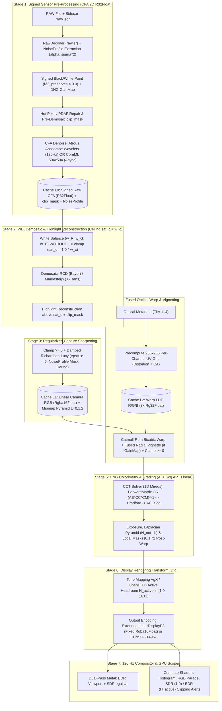

# Architectural, Mathematical, and Functional Specification — Rraw

> [!IMPORTANT]
> **Language & Governance Rule**: This specification is the authoritative English reference translated from the approved Gate 1 architectural plan. In accordance with repository governance, all files in this Git repository (`AGENTS.md`, `docs/agent/*.md`, Rust source code, WGSL shaders, comments, tests, and commit messages) MUST be written strictly in English.

---

## 1. Vision, Licensing & Engineering Governance

### 1.1 Positioning, Licensing & Native Dependency Policy

**Rraw** is a native macOS (Apple Silicon M-series) photographic RAW development workstation engineered to combine the mathematical rigor of a scientific processing engine (sensor-noise-calibrated wavelet and neural denoising, regularized Richardson-Lucy optical deconvolution, dual-illuminant spectral colorimetry in `ACEScg`, and 120 Hz ProMotion Extended Dynamic Range display rendering) within a modern, catalog-free Rust architecture.

- **Project License**: `GPL-3.0-or-later` (open-source). This enables clean, legally compliant integration of the pure-Rust RAW decoder `rawler` (`LGPL-2.1` / `GPL-2.0+` from `dnglab`) and the `Lensfun` optical database (`CC BY-SA 3.0`).
- **Dependency & FFI Policy**:
  - **100% Pure Rust for All Parsing and Business Logic**: Zero dependencies on legacy or attack-surface-heavy C/C++ parsing libraries (`LibRaw`, `exiv2`, `rexiv2`, `gobject`). All TIFF/ISOBMFF parsing, MakerNotes, DNG `OpcodeList`, Lensfun XML, and `.lcp` profile parsing MUST be implemented in safe Rust (`#![forbid(unsafe_code)]`).
  - **Explicitly Authorized and Isolated FFI Exceptions**: Only audited system or hardware-acceleration bindings under permissive licenses (`BSD-3-Clause` / `MIT` / `Apache-2.0`) are allowed inside dedicated crates:
    1. Apple system frameworks (`Metal`, `AppKit`, `CoreGraphics`, `QuartzCore`) via `wgpu` and `objc2` (isolated in the micro-crate `rraw-macos-edr`).
    2. CoreML / Apple Neural Engine inference via `ort` (ONNX Runtime, `MIT`, isolated in `rraw-ai`).
    3. 10/16-bit JPEG XL encoding via `jpegxl-rs` / `libjxl` (`BSD-3-Clause`, isolated in `rraw-export`). For 10/12-bit AVIF export, Rraw uses the pure-Rust `rav1e` + `avif-serialize` (`ravif`) stack.

### 1.2 Non-Negotiable Engineering Rules (`AGENTS.md` & `docs/agent/`)

Execution governance is built on formal repository contracts checked before every commit:

1. **Zero Production Crashes & `unsafe` Isolation (`E0453` Compliant)**:
   - Absolute prohibition of `.unwrap()`, `.expect()`, `panic!()`, `todo!()`, or `unimplemented!()` in production and test targets, enforced workspace-wide via `[workspace.lints.clippy]`:
     ```toml
     unwrap_used = "deny"
     expect_used = "deny"
     panic = "deny"
     todo = "deny"
     unimplemented = "deny"
     ```
   - In Rust, crate-level `#![forbid(unsafe_code)]` prohibits any submodule `#[allow(unsafe_code)]` override (compiler error `E0453`). Therefore, **10 of the 11 workspace crates enforce `#![forbid(unsafe_code)]`**, while the `objc2` bridge for `CAMetalLayer` / `NSScreen` is isolated in the 11th micro-crate **`rraw-macos-edr`**, configured with `#![deny(unsafe_code)]` and minimal `#[allow(unsafe_code)]` blocks backed by `// SAFETY:` invariants behind the safe `DisplayHeadroomProvider` trait in `rraw-core`.
2. **Strict TDD (`Red -> Verify Failure -> Green -> Refactor`)**:
   - Every algorithmic or structural unit starts with failing tests driven by **mathematically deterministic synthetic fixtures** (synthetic Bayer/X-Trans CFA patterns, calibrated Poisson-Gaussian noise, per-channel clipped highlights, analytic PSF blur, known optical distortion grids, analytic D50/D65 ColorChecker patches).
   - All GPU tests (`rraw-gpu`) run headless offscreen via `GpuContext::new_headless()`.
3. **Atomic Granularity**:
   - Each validated subtask is committed as a standalone compilable unit passing `cargo fmt --all -- --check`, `cargo clippy --workspace --all-targets -- -D warnings`, and `cargo test --workspace`.

---

## 2. Exact Functional Scope

### 2.1 Filesystem Explorer & Filmstrip (Catalog-Free DAM)

Rraw operates directly on the macOS filesystem without forcing users into a proprietary import catalog:

- **Direct Navigation**: Native folder tree, favorites, external volumes, and live filesystem watching (`notify`).
- **Asynchronous SQLite Index (`rusqlite`)**: Non-blocking local cache database indexing canonical EXIF/XMP metadata (`PhotoMetadata` in `rraw-core`) on the fly for visited folders, enabling sub-5 ms filtering and sorting over 50,000+ photos by:
  - Capture settings: ISO, aperture ($f/N$), focal length, camera body, lens model.
  - Rating & culling: Star rating (`0..5`), pick status (`Pick` / `Reject` / `Unflagged`), color label, keywords (`dc:subject`).
- **Mipmap Thumbnail Cache**: Ultra-fast extraction of embedded JPEG previews (step 0), asynchronously replaced in the background by exact pipeline-rendered thumbnails stored in a memory/disk mipmap pyramid.

### 2.2 Dual-Tier Hybrid Sidecar Architecture

Original RAW files are opened strictly read-only and never modified:

- **Native Recipe `<photo>.rraw.json`**: Deterministic, versioned JSON (`schema_version`) encoding the directed acyclic graph (DAG) of development parameters, local masks, virtual copies, and undo history.
- **Standard Interoperability `<photo>.xmp`**: Non-destructive XML read/write (`quick-xml`) for `xmp:Rating`, `xmp:Label`, and `dc:subject`, strictly preserving all third-party XML namespaces (`crs:*`, `darktable:*`, `lr:*`, etc.) intact.

### 2.3 Interactive 120 Hz ProMotion EDR / SDR Darkroom

The GUI combines `egui` (`eframe`) and `wgpu` (native Metal backend) with deterministic Apple Extended Dynamic Range (EDR) management via `rraw-macos-edr`:

- **Metal EDR Bridge (`CAMetalLayer`) & Fixed Surface Format Stability**:
  - The `wgpu::SurfaceConfiguration` format remains **permanently fixed at `TextureFormat::Rgba16Float`** with `wantsExtendedDynamicRangeContent = YES` and `CGColorSpace::extendedLinearDisplayP3`, regardless of target monitor (avoiding `egui_wgpu` black-screen regressions on dynamic texture format transitions).
- **Dual Dynamic Headroom Polling**:
  - Main-thread polling of **`NSScreen.maximumExtendedDynamicRangeColorComponentValue`** (live available EDR headroom at time $t$ factoring ambient brightness and system display settings) alongside `maximumPotentialExtendedDynamicRangeColorComponentValue` (hardware panel limit), observing `NSWindowDidChangeScreenNotification` and `NSApplicationDidChangeScreenParametersNotification`.
  - On an external SDR monitor, `maximumExtendedDynamicRangeColorComponentValue` returns `1.0`: the surface remains `Rgba16Float`, while the active headroom $H_{\text{active}}$ passed to the tone mapper is clamped to `1.0`. On an integrated Liquid Retina XDR display, $H_{\text{active}}$ dynamically spans up to `16.0` ($+4\text{ EV}$).
- **Dual-Pass Compositing**:
  - `egui` UI panels render in nominal SDR (`[0.0, 1.0]`), preventing glaring UI controls.
  - The image viewport renders into a linear `Rgba16Float` texture supporting values $> 1.0$ up to $H_{\text{active}}$.
- **Real-Time GPU Scopes**: Linear/logarithmic histogram and RGB Waveform/Parade computed via compute shaders (using shared `workgroup` memory reduction), plus dual clipping indicators (SDR clipping alert $> 1.0$ and EDR clipping alert $> H_{\text{active}}$).

### 2.4 Photographic Processing Modules

#### Module A — Sensor Calibration, `NoiseProfile` & Dual Denoising

1. **Signed Normalization & Zero-Mean Noise Preservation**:
   - Per-channel black-level subtraction ($2 \times 2$ Bayer or $6 \times 6$ X-Trans) and division by $(W_c - B_c)$:
     $$x_{\text{norm}}(p) = \frac{\text{RAW}(p) - B_c}{W_c - B_c} \in \mathbb{R}$$
   - **Fundamental Invariant**: The Stage 1 `R32Float` buffer (`Cache L0`) MUST remain **strictly signed** (`f32` allowing values $< 0.0$). Clamping negative values to `0.0` after black-level subtraction rectifies the lower tail of the Gaussian read-noise distribution, introducing a non-zero DC pedestal and color cast in deep shadows.
   - If a DNG contains a `GainMap` in `OpcodeList2` (CFA-domain sensor/vignette correction), it is applied here and sets `vignette_handled_by_gainmap = true` in pipeline metadata to prevent double vignetting correction at Stage 4.
2. **Physical Noise Calibration (`NoiseProfile`)**:
   - Extracted from DNG tag `NoiseProfile` (`0xc761`) or camera/ISO calibration tables providing per-channel Poisson shot-noise gain $\alpha_c$ (signal-proportional variance) and electronic read-noise variance $\sigma_{\text{read}, c}^2$:
     $$\text{Var}(x_{\text{norm}}) = \alpha_c \cdot \max(x_{\text{norm}}, 0.0) + \sigma_{\text{read}, c}^2$$
   - When calibrated metadata is absent, a robust **Median Absolute Deviation (MAD)** estimator over the highest-frequency wavelet subband ($\sigma_{\text{est}} = \text{MAD}(W_1) / 0.6745$) computes `NoiseProfile` automatically. This `NoiseProfile` drives both Stage 1 CFA denoising and Stage 3 Capture Sharpening protection $T_{\text{noise}}$.
3. **Sensor Defect Repair & Pre-Demosaic Clipping Mask**:
   - Local statistical hot/dead pixel detection and directional PDAF line interpolation.
   - Generation of a binary/continuous physical saturation mask ($\text{clip\_mask}(p) = \mathbb{I}[x_{\text{norm}}(p) \ge 0.999]$) attached to `Cache L0`.
4. **Dual Denoising Engine**:
   - **Real-Time Mode (120 Hz GPU)**: *À-Trous* wavelet filter operating under a Generalized Anscombe Transform (GAT) protected for signed inputs:
     $$z = \frac{2}{\alpha_c} \sqrt{\max\left(\alpha_c \cdot x_{\text{norm}} + \frac{3}{8}\alpha_c^2 + \sigma_{\text{read}, c}^2,\; 0.0\right)}$$
     After soft wavelet detail thresholding and exact unbiased inverse transformation, pixels centered around black retain zero statistical expectation.
   - **Studio AI Mode (CoreML / Apple Neural Engine via `ort`, `TileDenoiser` trait)**:
     - Asynchronous execution in **`504×504` pixel** tiles with a **`48` pixel** cosine-window ($\cos^2$) overlap (`stride = 456`). Both `504`, `48`, and `456` are divisible by `2` (Bayer period) and `6` (Fujifilm X-Trans period: $504 = 84 \times 6$, $48 = 8 \times 6$), guaranteeing `origin_x % 6 == 0 && origin_y % 6 == 0` for every tile.
     - **Edge Tile Alignment Invariant (`TileRegion`)**: Tiles MUST NEVER step backward onto unaligned right or bottom sensor edges. Each `TileRegion` records `origin_x`, `origin_y` (multiples of `6`), `valid_width`, `valid_height`, `pad_right = 504 - valid_width`, and `pad_bottom = 504 - valid_height`; boundary padding is filled via phase-preserving `6×6` mirror reflection when assembling the fixed `504×504` CoreML input tensor.
     - **FP16 ANE Conditioning**: Since the Apple Neural Engine executes in `float16`, each normalized CFA tile and variance map $(\alpha_c, \sigma_{\text{read}, c})$ undergoes dynamic-range pre-compression ($\log_2$ / normalized Anscombe mapping into $[0, 1]$) before ONNX inference, followed by inverse expansion back to `f32`, preventing FP16 underflow in high-ISO shadows.

#### Module B — Pre-Demosaic White Balance & Highlight Reconstruction

1. **Exact Per-Channel Clipping Threshold Tracking (`sat_c`)**:
   - White-balance multipliers $\mathbf{w} = (w_R, w_G, w_B)$ (typically $w_G = 1.0, w_R \approx 2.0, w_B \approx 1.5$) are applied prior to demosaicing so gradient estimators in RCD (Bayer) or Markesteijn (X-Trans) remain isotropic.
   - **Critical Physical Rule**: Values MUST NOT be clamped at `1.0` after multiplying by $\mathbf{w}$. The physical saturation ceiling for channel $c \in \{R, G, B\}$ becomes:
     $$\text{sat}_c = 1.0 \times w_c$$
   - The vector $\mathbf{sat} = (\text{sat}_R, \text{sat}_G, \text{sat}_B)$ and pre-demosaic `clip_mask` are passed directly to Highlight Reconstruction (`HLR`).
2. **Highlight Reconstruction (`HLR`)**:
   - A pixel $(x, y)$ has channel $c$ flagged as saturated if $I_c(x, y) \ge 0.99 \cdot \text{sat}_c$ or if its corresponding CFA neighborhood is flagged in `clip_mask`.
   - Whenever at least one channel remains unsaturated ($I_c < \text{sat}_c$), `HLR` reconstructs luminance and chromatic detail in clipped channels via chromatic-ratio propagation and opposing anisotropic diffusion between $\min_c(\text{sat}_c)$ and $\max_c(\text{sat}_c)$, completely eliminating magenta highlight casts before any spatial filter runs.

#### Module C — 4-Tier Optical Engine & Regularized Capture Sharpening

Hierarchical automatic or manual correction of optical aberrations:

- **Tier 1 (Highest Priority — Embedded RAW Geometric Metadata)**:
  - DNG standard: `OpcodeList1`, `OpcodeList2`, `OpcodeList3` (`WarpRectilinear`, `WarpFisheye`, `FixVignetteRadial`, `GainMap`).
  - Manufacturer tags carrying explicit polynomials/splines: Sony (`0x2010` distortion/vignette/CA spline tables), Nikon Z (`0xc7d5`), Fujifilm (`FujiIFD` geometry & vignetting), Micro Four Thirds / Panasonic.
  - *Note on Canon `.CR3`*: Canon `.CR3` MakerNotes provide lens identifiers (`LensType`) and status flags rather than full polynomial tables; they automatically and cleanly fall back to Tier 2 (`Lensfun`) or Tier 3 (`.lcp`).
- **Tier 2 (Embedded `Lensfun` XML Database — `CC BY-SA 3.0`)**: `PTLens`, `Poly3`, `Poly5` distortion models, fisheye mapping, and $\cos^4(\theta)$ radial vignetting.
- **Tier 3 (Local Adobe `.lcp` Profiles)**: Loaded upon user permission from local `.lcp` installations (`Brown-Conrady` distortion with tangential terms and per-channel radial chromatic aberration).
- **Tier 4 (Manual Controls & Regularized Optical Deconvolution)**:
  - Manual distortion, vignetting, and CA sliders.
  - **Capture Sharpening (Damped, Bounded, Regularized Richardson-Lucy)**:
    - At Stage 3 input, the post-HLR camera signal is clamped to the non-negative half-space: $I^{(0)}(x) = \max(I_{\text{HLR}}(x), 0.0)$.
    - 5 to 10 iterations with $\epsilon = 10^{-6}$ denominator protection against division by zero in deep blacks:
      $$I^{(k+1)}(x) = I^{(k)}(x) \cdot \left[ 1 + M_{\text{edge}}(x) \cdot \left( \left( \frac{I^{(0)}}{\max(I^{(k)} * \text{PSF}_r,\; 10^{-6})} * \text{PSF}_r^T \right)(x) - 1 \right) \right]$$
    - The regularization mask $M_{\text{edge}}(x) = \text{smoothstep}\!\left(\gamma \cdot \sqrt{\alpha \cdot I^{(0)}(x) + \sigma_{\text{read}}^2},\; 3\gamma \cdot \sqrt{\alpha \cdot I^{(0)}(x) + \sigma_{\text{read}}^2},\; |\nabla I^{(0)}(x)|\right) \in [0, 1]$ is indexed directly on Stage 1's **`NoiseProfile`**. It **protects 100% of flat regions (sky, bokeh, shadows)** against noise amplification, reinforced by a local min/max overshoot (*dering*) limiter and radially varying center-to-corner $\text{PSF}_r$.

#### Module D — DNG Spectral Colorimetry, Grading & Tone Mapping

1. **Iterative CCT Solver & 1D Linear Mired Interpolation**:
   - Given scene neutral $\mathbf{n} = \text{CameraNeutral}$ (`AsShotNeutral` or Temperature/Tint sliders), a DNG iterative fixed-point solver (3–5 iterations on chromaticity $(x_D, y_D)$ along the Planckian / CIE Daylight locus) computes correlated color temperature $T_{\text{K}}$ and reciprocal megakelvin (**mireds**) $M = 10^6 / T_{\text{K}}$.
   - All interpolation between dual-illuminant calibration matrices ($M_1 = 10^6 / T_1$, typically `StdA` $2856\text{ K} \approx 350.1\text{ mireds}$, and $M_2 = 10^6 / T_2$, typically `D65` $6504\text{ K} \approx 153.8\text{ mireds}$) is **1D linear interpolation in mireds** (clamped at boundaries when $M \notin [M_2, M_1]$):
     $$t = \text{clamp}\!\left(\frac{M - M_1}{M_2 - M_1},\; 0.0,\; 1.0\right), \quad \mathbf{A}(M) = (1 - t)\,\mathbf{A}_1 + t\,\mathbf{A}_2$$
2. **Strict Separation of the Two DNG Matrix Paths to `ACEScg` (`AP1` D60)**:
   - **Path A — `ForwardMatrix1/2` Present (Priority)**:
     Per DNG specification, $\mathbf{FM}(M)$ maps **already white-balanced** camera RGB ($\mathbf{c}_{\text{wb}} = \text{diag}(\mathbf{w}) \cdot \mathbf{c}_{\text{cam}}$) directly to `CIE XYZ D50`. The composite transform to `ACEScg` (`AP1` D60 white point) is:
     $$\mathbf{M}_{\text{cam\_wb} \to \text{ACEScg}} = \mathbf{M}_{\text{XYZ\_D60} \to \text{AP1}} \cdot \mathbf{M}_{\text{Bradford}}(\text{D50} \to \text{D60}) \cdot \mathbf{FM}(M)$$
   - **Path B — `ColorMatrix1/2` Fallback (No `ForwardMatrix`)**:
     Per DNG specification, $\mathbf{CM}(M)$ maps `CIE XYZ` (under estimated scene illuminant $\text{WP}_{\text{scene}}(M)$) to unbalanced raw camera RGB: $\mathbf{M}_{\text{XYZ} \to \text{cam}} = \mathbf{AB} \cdot \mathbf{CC}(M) \cdot \mathbf{CM}(M)$. Because pixels were already multiplied by $\text{diag}(\mathbf{w})$ at Stage 2, we undo $\text{diag}(\mathbf{w})$, invert $(\mathbf{AB} \cdot \mathbf{CC}(M) \cdot \mathbf{CM}(M))^{-1}$ to obtain `XYZ` under $\text{WP}_{\text{scene}}(M)$, and apply Bradford chromatic adaptation from $\text{WP}_{\text{scene}}(M)$ to `D60`:
     $$\mathbf{M}_{\text{cam\_wb} \to \text{ACEScg}} = \mathbf{M}_{\text{XYZ\_D60} \to \text{AP1}} \cdot \mathbf{M}_{\text{Bradford}}(\text{WP}_{\text{scene}}(M) \to \text{D60}) \cdot \left(\mathbf{AB} \cdot \mathbf{CC}(M) \cdot \mathbf{CM}(M)\right)^{-1} \cdot \text{diag}(\mathbf{w})^{-1}$$
3. **Identity-Core `Gamut Guard`**:
   - Before matrix multiplication, negative undershoots from Stage 4 Catmull-Rom bicubic sampling are eliminated via $\mathbf{c}_{\text{in}} = \max(\mathbf{c}_{\text{warp}}, 0.0)$.
   - Soft `AP1` gamut compression acts **strictly as the identity ($\mathbf{x} \mapsto \mathbf{x}$) inside a core covering 85% of the `AP1` spectral triangle** (encompassing 100% of `sRGB`, `Display P3`, and all 24 ColorChecker patches, ensuring $\Delta E_{00} < 0.01$), compressing only extreme peripheral out-of-gamut spectra (monochromatic blue LEDs / neons).
4. **Grading & Local Masks in Post-Warp Normalized Coordinates**:
   - Exposure (EV), multi-scale halo-free local contrast (Laplacian Pyramid), color wheels, and **Local Masks** (linear/radial gradients and parametric Luminance, Chroma, and Hue masks evaluated in `ACEScg`).
   - **Geometric Reference Frame**: All geometric masks live in **`[0, 1]²` post-warp, post-crop normalized coordinates (Stage 4 output)**, guaranteeing that user masks never drift if optical lens corrections change.
5. **Display Rendering Transforms (DRT)**:
   - **AgX** (with parametric analytical shoulder extension for EDR) and **OpenDRT**, parameterized by *Live Display Headroom* ($H_{\text{active}} \in [1.0, 16.0]$).

#### Module E — Multi-Threaded Batch Export Engine

Asynchronous multi-threaded export queue supporting:

- **Classic Formats**: 16-bit TIFF (linear or gamma), 16-bit PNG, 8-bit JPEG with 4:4:4 chroma subsampling.
- **HDR & Next-Gen Formats**: 10/12-bit AVIF (`rav1e` + `avif-serialize`) and 10/16-bit JPEG XL (`libjxl` `BSD-3-Clause`), embedding ICC profiles (`sRGB`, `Display P3`, `Rec.2020 PQ/HLG`) and generating **ISO 21496-1 HDR Gain Maps** emitting **both** the standardized binary ISO 21496-1 payload (`tmap` box in ISOBMFF / `APP2` MPF in JPEG) **and** XMP `hdrgm:*` metadata for universal macOS/iOS/Android/Chrome compatibility.

---

## 3. 7-Stage Physical Pipeline, Concurrency & Multi-Level DAG Cache



### 3.1 Fused Vignetting inside Stage 4 (`WARP`)

Instead of executing a separate full-screen memory pass for radial vignetting prior to geometric warping (`WARP`), radial vignette gain $V(r_{\text{distorted}})$ is evaluated **directly inside the `WARP` shader** from the coordinates sampled out of the `Cache L2` LUT (only when `vignette_handled_by_gainmap == false`), followed by `max(rgb, 0.0)` to remove Catmull-Rom negative lobes before Stage 5. This saves a full 360 MB VRAM read/write round-trip on a 45 MP image.

### 3.2 120 Hz Interactive Scrubbing (Stages 1–3), AI Concurrency & LRU VRAM Budget

1. **Interactive Scrubbing of Stages 1–3 Controls (WB, Wavelet Denoise, Capture Sharpening)**:
   - Recomputing an entire 45–100 MP sensor through RCD/Markesteijn and 10 Richardson-Lucy iterations takes 25–60 ms, missing the 8.33 ms (120 Hz) budget.
   - **RoI Scrubbing Mode (`is_scrubbing == true`)**: While the user actively drags a Stage 1–3 slider, the GPU executes Stages 1, 2, and 3 exclusively over the **visible viewport sub-window (or zoom-matched CFA downsample level) padded by a 32-pixel halo** (covering wavelet support + demosaic radius + 10 RL iterations). Viewport execution time stays **< 2.5 ms (120 Hz guaranteed)**.
   - **Asynchronous Consolidation (`on_mouse_up` / 150 ms debounce)**: Upon slider release, full-resolution `Cache L1` (`1:1` plus its mipmap pyramid) rebuilds in the background in $1024 \times 1024\text{ px}$ GPU tiles without blocking UI submission.
2. **Lock-Free Concurrency Protocol Between `rraw-ai` (CoreML) and `rraw-gpu` (`wgpu`)**:
   - Every Stage 0/1 mutation monotonically increments a **`(PhotoId, Stage0Epoch)`** token.
   - The async `rraw-ai` worker checks a `CancellationToken` before every `504×504` tile. Switching photos or modifying black levels cancels stale AI jobs in < 15 ms.
   - Until CoreML inference completes, the viewport renders GPU À-Trous wavelets instantaneously (`QualityTier::InteractiveWavelet`). Once all `504×504` tiles for a matching epoch finish assembling in RAM, they upload via `Queue::write_texture` into a fresh `wgpu::Texture`, an atomic `ArcSwap<CachedStage0>` pointer flips `Cache L0` to `QualityTier::NeuralCoreMl`, and tiled `Cache L1` regeneration triggers.
3. **Strict VRAM Budget Cap (LRU Eviction Policy)**:
   - `rraw-gpu`'s cache manager enforces a configurable memory cap (default `min(2048 MB, 25% of unified system memory)`).
   - Only the **active photo** retains full `Cache L0` (`R32Float`, ~180 MB at 45 MP) and `Cache L1` (`Rgba16Float` + mipmaps, ~480 MB at 45 MP) textures resident in VRAM. Switching photos in the filmstrip immediately downgrades or evicts older photos under strict **LRU** accounting.

### 3.3 Scale-Invariance Guarantee

Let $\text{downsample\_factor} \in \{1, 2, 4\}$ be the mipmap downsampling factor of `Cache L1` (generated via anti-aliased box/Lanczos filtering from the `1:1` post-Richardson-Lucy image), and let the integer mipmap level be:

$$L = \log_2(\text{downsample\_factor}) \in \{0, 1, 2\}$$

Stage 5 multi-scale operators (Laplacian Pyramid local contrast) execute exactly:

$$N_{\text{effective}} = N_{\text{octaves}} - L$$

octaves, skipping the $L$ highest-frequency octaves already integrated during downsampling. Consequently, a fit-to-screen image (`1:4`, $L = 2$) produces matching global and local tonal response to a `1:1` zoom view ($L = 0$).

---

## 4. 11-Crate Cargo Workspace Decomposition

The workspace strictly enforces acyclic dependencies, isolates macOS `unsafe` FFI in `rraw-macos-edr`, and shares the CPU reference pipeline between `rraw-cli` and automated tests:

| Crate | `unsafe` Policy | Role and Responsibilities | Internal Dependencies |
| :--- | :---: | :--- | :--- |
| **`rraw-core`** | `#![forbid(unsafe_code)]` | Core types (`ImageBuffer`, `CfaPattern`, `NoiseProfile`, `PhotoMetadata`, `PhotoId`, `Stage0Epoch`), versioned `.rraw.json` recipe DAG, core traits (`DisplayHeadroomProvider`, `TileDenoiser`), typed errors, geometry. | *None* |
| **`rraw-decode`** | `#![forbid(unsafe_code)]` | `RawDecoder` trait, `rawler` adapter, pure-Rust TIFF/ISOBMFF parsers, DNG `OpcodeList1..3`, `NoiseProfile` (`0xc761` + MAD fallback), optical MakerNotes (Sony, Nikon, Fuji, M4/3). | `rraw-core` |
| **`rraw-optics`** | `#![forbid(unsafe_code)]` | 4-tier optical resolver, `Lensfun` XML parser, `.lcp` parser, $256 \times 256$ UV LUT generator (Distortion + CA), radial PSF kernel, CPU Richardson-Lucy reference operator. | `rraw-core`, `rraw-decode` |
| **`rraw-color`** | `#![forbid(unsafe_code)]` | Iterative CCT solver (1D mired interpolation), `ForwardMatrix` & `ColorMatrix` -> Bradford -> `ACEScg`, identity-core Gamut Guard, `AgX` / `OpenDRT`, and **shared CPU reference pipeline**. | `rraw-core`, `rraw-optics` |
| **`rraw-gpu`** | `#![forbid(unsafe_code)]` | `wgpu` context (`new_headless()` for tests + UI surface), WGSL shaders (Stages 1–7), LRU DAG cache manager (`L0`/`L1`/`L2` + 120 Hz RoI scrubbing), GPU scopes. | `rraw-core`, `rraw-optics`, `rraw-color` |
| **`rraw-ai`** | `#![forbid(unsafe_code)]` | `TileDenoiser` implementation (`ort` CoreML EP), FP16 Anscombe/log conditioning, `504×504` tile slicing/blending (`48px` cosine overlap), epoch-based cancellation. | `rraw-core` |
| **`rraw-storage`** | `#![forbid(unsafe_code)]` | Async `rusqlite` DAM index over `PhotoMetadata`, non-destructive `.xmp` and `.rraw.json` sidecar reader/writer, disk thumbnail cache manager. | `rraw-core`, `rraw-decode` |
| **`rraw-export`** | `#![forbid(unsafe_code)]` | Batch export queue, TIFF/PNG/JPEG/AVIF (`rav1e`)/JXL (`libjxl`) encoders, ICC profiles, ISO 21496-1 HDR Gain Map generator (binary `tmap` + XMP `hdrgm:*`). | `rraw-core`, `rraw-gpu`, `rraw-color` |
| **`rraw-macos-edr`** | `#![deny(unsafe_code)]` *(audited blocks only)* | Micro-crate isolating `objc2` (`CAMetalLayer`, `CGColorSpace::extendedLinearDisplayP3`, `NSScreen.maximumExtendedDynamicRangeColorComponentValue`) behind `DisplayHeadroomProvider`. | `rraw-core` |
| **`rraw-cli`** | `#![forbid(unsafe_code)]` | Lightweight CLI orchestrating the CPU/GPU reference pipelines (`rraw-color` / `rraw-gpu` / `rraw-export`) for profiling, optical inspection, and golden tests. | All lib crates except `rraw-macos-edr` |
| **`rraw-app`** | `#![forbid(unsafe_code)]` | Native macOS application (`eframe`/`egui` + `wgpu` Metal), Browser/Filmstrip views, and 120 Hz EDR Darkroom consuming `DisplayHeadroomProvider`. | All 9 library crates |

---

## 5. Phased TDD Execution Roadmap

Each task follows **Red -> Verify Failure -> Green -> Refactor** and undergoes adversarial Inquisitor audit prior to Gate 3 commit approval:

### Phase 0 — Governance, Documentation & 11-Crate Workspace Skeleton
- **Task 0.1**: Create `AGENTS.md`, `README.md`, `LICENSE` (`GPL-3.0-or-later`), `docs/studies/ARCHITECTURE.md`, and the complete 10-file `docs/agent/` governance suite in English, plus `.gitignore`, `rust-toolchain.toml`, and `.git/hooks/pre-commit`.
- **Task 0.2**: Initialize root `Cargo.toml` with workspace lints (`unwrap_used = "deny"`, `expect_used = "deny"`, `panic = "deny"`, `todo = "deny"`, `unimplemented = "deny"`) and all 11 compilable crates (`10` under `#![forbid(unsafe_code)]`, `rraw-macos-edr` under `#![deny(unsafe_code)]`) with contract/smoke unit tests.

### Phase 1 — Mathematical Foundations, Pure-Rust Decoding, Colorimetry & CLI
- **Task 1.1 (`rraw-core`)**: `.rraw.json` parameter DAG (canonical serialization, stage-scoped deterministic hashing for L0/L1/L2), `NoiseProfile`, `PhotoMetadata`, and `CfaPattern` (Bayer $2 \times 2$, X-Trans $6 \times 6$).
  - *TDD Gate*: Changing exposure invalidates display hash while keeping L0, L1, and L2 cache hashes strictly identical.
- **Task 1.2 (`rraw-decode`)**: `RawDecoder` trait (`rawler` adapter + synthetic RAW generator), `NoiseProfile` extraction (`0xc761` + wavelet MAD fallback), and binary DNG `OpcodeList1..3` parser (`WarpRectilinear`, `FixVignetteRadial`, `GainMap` setting `vignette_handled_by_gainmap`).
  - *TDD Gate*: Decode synthetic DNG 1.7 `OpcodeList3` + `GainMap` streams bit-exact; verify MAD recovers synthetic noise $\sigma = 0.02$ within $\pm 2\%$; verify sub-black samples stay signed ($< 0.0$) with zero mean ($|\mu| < 10^{-4}$).
- **Task 1.3 (`rraw-color`)**: Iterative CCT solver, 1D mired interpolation, separated `ForwardMatrix1/2` and `ColorMatrix1/2` -> Bradford -> `ACEScg` paths with identity-core Gamut Guard, and `AgX` / `OpenDRT` curves parameterized by $H_{\text{active}}$.
  - *TDD Gate*: Verify $\Delta E_{00} < 0.01$ across all 24 analytical ColorChecker patches on both matrix paths, and verify `AgX(x, H)` is strictly monotonically increasing ($df/dx > 0$) and bounded by $H$ on $x \in [0, 100]$.
- **Task 1.4 (`rraw-cli`)**: Shared CPU reference pipeline (signed normalization -> WB with $\text{sat}_c = w_c$ -> RCD demosaic -> HLR -> colorimetry -> 16-bit PNG export).
  - *TDD Gate*: Linear luminance ramp up to physical saturation with $w_R = 2.1, w_G = 1.0, w_B = 1.6$ exhibits zero false color or magenta ring up to $\text{sat}_c$ ($R = G = B$ after matrix within $10^{-4}$).

### Phase 2 — Headless `wgpu` GPU Pipeline, LRU DAG Cache & 120 Hz EDR Viewport
- **Task 2.1 (`rraw-gpu`)**: `GpuContext::new_headless()` and WGSL compute shaders for Stage 1 (signed normalization, hot-pixel repair, bounded-Anscombe À-Trous wavelets) and Stage 2 (unclamped WB, RCD/Markesteijn demosaic, HLR using $\text{sat}_c = w_c$ and `clip_mask`).
  - *TDD Gate (Headless GPU)*: Synthetic Siemens star PSNR $> 42\text{ dB}$; clipped solar disk on $R$ and $G$ recovers radial gradient above $1.0$ up to $\max(w_c)$ without magenta ringing.
- **Task 2.2 (`rraw-gpu`)**: L0/L1/L2 cache manager with LRU VRAM cap, 120 Hz RoI scrubbing for Stages 1–3, mipmap pyramid ($L \in \{0, 1, 2\}$), and Stage 5–7 shaders (`ACEScg`, $N_{\text{octaves}} - L$ Laplacian pyramid, `AgX`/`OpenDRT`, GPU histogram/parade).
  - *TDD Gate (Headless GPU)*: Scale-invariance RMSE $< 0.5\%$ between `1:1` ($L=0$) and `1:4` ($L=2$); 5th photo inserted into a 2-photo LRU cap cleanly evicts oldest VRAM textures.
- **Task 2.3 (`rraw-macos-edr` & `rraw-app`)**: `DisplayHeadroomProvider` implementation (`maximumExtendedDynamicRangeColorComponentValue`), permanently fixed `Rgba16Float` surface format, and dual-pass compositor (`rraw-app`: SDR UI + EDR viewport).
  - *TDD Gate*: Mocked `DisplayHeadroomProvider` transition `H_active = 4.0` -> `H_active = 1.0` keeps surface format fixed at `Rgba16Float`, clamps viewport output to `1.0`, and preserves `egui` UI color invariance.

### Phase 3 — 4-Tier Optical Engine & Regularized Capture Sharpening
- **Task 3.1 (`rraw-optics` & `rraw-gpu`)**: Optical MakerNote parsers (Sony `0x2010`, Nikon `0xc7d5`, Fuji, M4/3; Canon `.CR3` Tier 2 fallback), `Lensfun` XML (`PTLens`, `Poly3`, `Poly5`), local `.lcp` (`Brown-Conrady`), $256 \times 256$ per-channel UV LUTs, and `WARP` shader fusing radial vignetting (skipped when `vignette_handled_by_gainmap == true`) and `max(rgb, 0.0)`.
  - *TDD Gate*: Analytic pincushion + R/B lateral CA + $\cos^4(\theta)$ vignette inverted via Catmull-Rom yields rectilinearity error $< 0.05\text{ px}$, zero negative outputs ($< 0.0$), and zero double-vignetting when `vignette_handled_by_gainmap == true`.
- **Task 3.2 (`rraw-optics` & `rraw-gpu`)**: Damped Richardson-Lucy Capture Sharpening (5–10 iterations, $\epsilon = 10^{-6}$, input $\ge 0$) with `NoiseProfile` edge mask and local overshoot deringing.
  - *TDD Gate*: Combined black `0.0` + Gaussian-blurred edge ($\sigma = 1.1\text{ px}$) + Poisson-Gaussian noisy flat patch yields zero `NaN`/`Inf`, $\ge +35\%$ MTF50 edge slope improvement, **$< +1\%$ noise variance increase in the flat region**, and zero ringing.

### Phase 4 — CoreML AI (`504×504` Tiling), Local Masks, DAM & HDR Export
- **Task 4.1 (`rraw-ai`)**: `504×504` tile slicer/blender with `48px` cosine overlap (Bayer $2\times 2$ and X-Trans $6\times 6$ phase-preserving), FP16 Anscombe/log conditioning, `(PhotoId, Stage0Epoch)` cooperative cancellation, and `ort` CoreML EP integration.
  - *TDD Gate (CFA-Phase-Sensitive)*: Pass a $2000 \times 1500$ X-Trans $6 \times 6$ pattern through tiling with a **phase-sensitive test operator $(x \bmod 6, y \bmod 6)$** applying distinct per-color gains; reconstruction error across tile seams and the full image MUST be $< 10^{-6}$ in `f32`.
- **Task 4.2 (`rraw-gpu` & `rraw-app`)**: Geometric masks (linear, radial) in post-warp/post-crop `[0, 1]²` coordinates and parametric masks (Luminance, Chroma, Hue in `ACEScg`) at 120 Hz.
- **Task 4.3 (`rraw-storage` & `rraw-app`)**: Async SQLite metadata indexing on `PhotoMetadata`, non-destructive `.xmp` reader/writer preserving third-party namespaces, and filesystem browser/filmstrip.
  - *TDD Gate*: Read `.xmp` with `crs:ToneCurvePV2012` and `darktable:history`, update `xmp:Rating` and `dc:subject`, rewrite, and assert byte/node identity of third-party XML nodes.
- **Task 4.4 (`rraw-export`)**: Multi-threaded exporter for 16-bit TIFF/PNG, JPEG, AVIF (`rav1e` + `avif-serialize`), JPEG XL (`libjxl`), and full ISO 21496-1 HDR Gain Maps (binary `tmap` box + XMP `hdrgm:*`).
  - *TDD Gate*: Export $+3\text{ EV}$ HDR image with ISO 21496-1 Gain Map, parse both binary `tmap` ISOBMFF/APP2 box and XMP `hdrgm:*`, and verify HDR reconstruction from SDR base + Gain Map recovers linear highlights up to `8.0` within $< 1\%$.

### Phase 5 — Native macOS Interactive GUI Shell
- **Task 5.1 (`rraw-app`)**: `eframe` / `egui` native macOS window shell with live EDR headroom query, Darkroom grading sliders (Exposure, WB, Contrast, Denoise, Optics), RAW file selector (`rfd`), and `--summary` headless mode fallback.

### Phase 6 — Extended Color, Presets, AI Masks & Timelapse Engine (Complete)
- **Task 6.1 (`rraw-gpu` & `rraw-app`)**: Interactive PCHIP splines in Stage 5 WGSL with live histogram underlay & in/out coordinate readout.
- **Task 6.2 & 6.2b (`rraw-color`, `rraw-gpu` & `rraw-app`)**: 3D CLUT engine, `.cube` parser/exporter, film profiles (Portra, Velvia, Classic Chrome, Tri-X, HP5), and hardware trilinear `texture_3d<f32>` at 120 FPS.
- **Task 6.3 (`rraw-core`, `rraw-ai`, `rraw-gpu` & `rraw-app`)**: CoreML AI semantic segmentation masks (`Subject`, `Sky`, `Background`, `Portrait`) with bilateral refinement and local grading.
- **Task 6.4 (`rraw-color` & `rraw-app`)**: Color management & soft proofing with paper/ink simulation and magenta/cyan gamut alert overlay.
- **Task 6.5 (`rraw-export` & `rraw-app`)**: RAW timelapse exporter with Savitzky-Golay temporal deflicker and Holy Grail day-to-night keyframe ramping.

### Phase 7 — Advanced Demosaicing & Noise Reduction Engine
- **Task 7.1 (`rraw-core` & `rraw-app`)**: Edge-Aware Adaptive Demosaicing (Directional green gradient interpolation / RCD-inspired filter eliminating zippering & false color on high-contrast edges).
- **Task 7.2 (`rraw-core` & `rraw-app`)**: Guided Bilateral & Wavelet Chrominance Denoise (Targeted high-ISO color speckle / blotch suppression without luminance edge blurring).
- **Task 7.3 (`rraw-gpu` & `rraw-app`)**: Luminance Denoise & Micro-Contrast Preservation (Inspector sliders in `DarkroomSection::DetailDenoise`, sidecar persistence, interactive 60-120 FPS feedback & 1:1 full-resolution export).

### Phase 8 — Complete Optical Correction Suite
- **Task 8.1 (`rraw-optics` & `rraw-app`)**: Chromatic Aberration Auto-Detection & Axial/Lateral Defringe (Purple and green fringing suppression with edge-threshold and hue span controls).
- **Task 8.2 (`rraw-optics` & `rraw-app`)**: Lens Profile Matching & Metadata Linking (Exif LensModel/FocalLength matching with Lensfun / DNG OpcodeList3 formulas and strength sliders).
- **Task 8.3 (`rraw-app`)**: Enhanced Optical Inspector UI in `DarkroomSection::OpticalCorrections` (Auto-Profile vs Manual mode, interactive defringe preview, sidecar persistence and reset).

### Phase 9 — Local Masking & Selective Grading Engine
- **Task 9.1 (`rraw-core` & `rraw-app`)**: Local Masking DAG & Data Model (`LinearGradientMask`, `RadialGradientMask`, `BrushStrokeMask` with local EV, Contrast, Temperature, Saturation, Sharpness).
- **Task 9.2 (`rraw-app` & `rraw-gpu`)**: Interactive Viewport Overlay & Canvas Tooling (Direct mouse drag for linear/radial gradients with rotation & feather handles, brush stroke painting with radius/hardness).
- **Task 9.3 (`rraw-app`)**: Local Mask Layer Stack Inspector & Pipeline Compositor (Layer list, enable/disable, invert, opacity, blend with CoreML AI semantic masks, multi-scale export).
