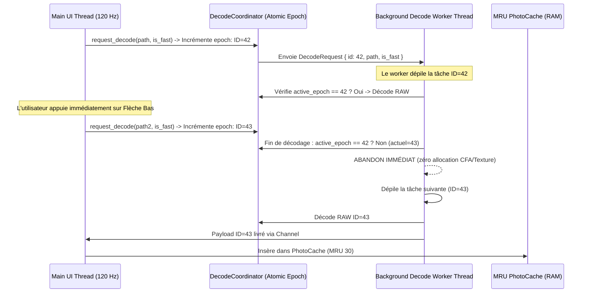
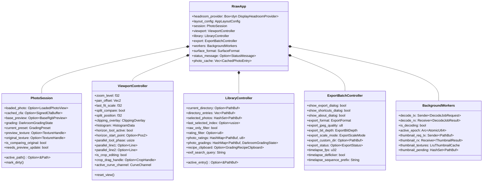

# Étude Architecturale — Phase 16 : Robustesse Concurrente, Cycle de Vie VRAM & Décomposition du Contrôleur GUI

> **Statut** : Validé pour implémentation  
> **Cible** : Workspace `Rraw` (`crates/rraw-app`, `crates/rraw-core`)  
> **Auteurs** : Équipe Antigravity / Google DeepMind  
> **Date** : 22 Novembre 2026  
> **Prérequis** : Phase 15 complétée (278 tests verts, 0 warning Clippy, audit Inquisitor APPROVED)

---

## 1. Contexte & Objectifs

L'audit approfondi de maturité (v2) du 22 novembre 2026 a établi une note de **8.4 / 10** pour Rraw, saluant le désendettement majeur réalisé sur le cœur mathématique, les shaders WGSL, l'i18n et les panneaux de l'inspecteur. Cependant, deux risques systémiques résiduels limitent le passage au niveau industriel :

1. **Risque Concurrence & VRAM (Option A)** :
   - Des requêtes de décodage RAW asynchrones sont émises via des `std::thread::spawn` bruts et non bornés, sans annulation de tâche (*cancellation token*).
   - Les textures GPU de vignettes (`thumbnail_textures: HashMap<PathBuf, egui::TextureHandle>`) ne disposent d'aucun plafond d'éviction LRU et ne sont jamais purgées au changement de dossier.
2. **Risque Architectural & Dette Contrôleur (Option B)** :
   - `RrawApp` concentre **73 champs directs** dans une structure plate de 1 750 lignes.
   - Ce couplage excessif bloque le *borrow checker* en exigeant `&mut self` pour la moindre sous-opération graphique, interdit les tests unitaires isolés et dilue le principe de moindre privilège.

La **Phase 16** a pour objectif de résoudre conjointement ces deux problématiques sans régression fonctionnelle ni perte de performance.

---

## 2. Volet A : Concurrence Bornée, Annulation de Tâches & Éviction VRAM

### 2.1 Le Problème Actuel du Décodage Asynchrone
Actuellement dans `crates/rraw-app/src/app.rs` :
```rust
// Dans navigate_relative_with_shift ou open_photo :
std::thread::spawn(move || {
    if let Some(payload) = decode_photo_file_payload(&path, true) {
        let _ = tx.send(payload);
    }
});
```
Lorsqu'un utilisateur fait défiler 40 photos à la seconde avec la flèche directionnelle :
- 40 threads OS natifs sont lancés simultanément.
- 40 dématriçages RAW lourds (Bayer / X-Trans) s'exécutent en concurrence, saturant le CPU et la RAM.
- En cas de complétion désordonnée (*out-of-order execution*), une photo décodée plus lentement peut écraser à l'écran la photo courante active (*stale payload display*).

### 2.2 Architecture de la Solution : `DecodeJobCoordinator` avec Jeton d'Époque
Nous introduisons un mécanisme de coordination asynchrone non-bloquant :



#### Invariants Garantis :
1. **Zéro thread orphelin** : un worker unique (ou pool dimensionné `rayon`) consomme les requêtes.
2. **Annulation précoce** : si l'ID de la tâche ne correspond plus à l'époque active, le worker court-circuite le pipeline dès la sortie de `read_file` ou du dématriçage.
3. **Protection contre l'écrasement fantôme** : l'UI rejette tout payload reçu dont l'`epoch` ne correspond pas au document actif.

### 2.3 Éviction VRAM des Miniatures (`LruThumbnailCache`)
Actuellement, `thumbnail_textures: HashMap<PathBuf, egui::TextureHandle>` est non borné.
Nous remplaçons cette table par une structure dédiée `LruThumbnailCache` :

```rust
pub struct LruThumbnailCache {
    textures: HashMap<PathBuf, egui::TextureHandle>,
    access_order: VecDeque<PathBuf>,
    capacity: usize, // e.g. 256 vignettes actives max
}

impl LruThumbnailCache {
    pub fn new(capacity: usize) -> Self { ... }
    pub fn insert(&mut self, path: PathBuf, handle: egui::TextureHandle);
    pub fn get_mut(&mut self, path: &Path) -> Option<&mut egui::TextureHandle>;
    pub fn prune_on_directory_change(&mut self, new_entries: &[PathBuf]);
}
```
- **Capacité maximale fixe** (256 vignettes) : évite toute saturation VRAM sur les banques de 10 000+ RAWs.
- **Nettoyage au changement de dossier** (`open_directory`) : toutes les textures de l'ancien dossier n'étant plus affichées sont immédiatement détruites, libérant la mémoire graphique.

---

## 3. Volet B : Décomposition Modulaire du Contrôleur `RrawApp`

### 3.1 Découpage en 5 Contrôleurs de Domaine Spécialisés

Pour éliminer l'anti-pattern du *God Object*, `RrawApp` est découpé selon le diagramme de classes suivant :



### 3.2 Bénéfices Directs
1. **Émancipation du Borrow Checker** :
   - On peut désormais appeler : `render_viewport(&mut self.viewport, &self.session, &self.workers.thumbnail_textures)` sans collision de mutabilité.
2. **Moindre Privilège** :
   - Les panneaux d'export reçoivent `&mut self.export` au lieu de tout `RrawApp`.
   - Les outils de recadrage/perspective reçoivent `&mut self.viewport` et `&self.session`.
3. **Isolation et Tests Unitaires** :
   - `ViewportController` peut être instancié dans un test pour valider les mathématiques de zoom/pan sans monter le moteur de décodage ou les threads.

---

## 4. Découpage des Tâches de la Phase 16

La Phase 16 est articulée en 3 tâches séquentielles :

- **Task 16.1 (`rraw-app`) : Moteur de Concurrence Bornée, Annulation de Tâches & Éviction VRAM (Option A)**
  - Implémentation du worker thread de décodage avec coordination d'époque atomique (`Arc<AtomicU64>`) éliminant les `thread::spawn` bruts.
  - Annulation automatique des requêtes périmées lors de la navigation rapide.
  - Implémentation de `LruThumbnailCache` borné (256 vignettes) et purge des textures au changement de dossier dans `open_directory()`.
  - TDD : suite de tests `concurrency_and_cache_tests.rs`.

- **Task 16.2 (`rraw-app`) : Décomposition du Contrôleur `RrawApp` en Sous-États Spécialisés (Option B)**
  - Extraction de `PhotoSession`, `ViewportController`, `LibraryController`, `ExportBatchController`, et `BackgroundWorkers` sous `crates/rraw-app/src/state/` ou modules dédiés.
  - Refactorisation des call-sites dans `app.rs`, `ui/`, `preview/` et la boucle `eframe::App::ui`.
  - Préservation stricte de la compatibilité ascendante et de la réactivité 120 FPS.
  - TDD : suite de tests `controller_modularization_tests.rs`.

- **Task 16.3 (`rraw-app`) : Validation Globale, Tests de Charge & Audit Impitoyable**
  - Test de stress de défilement rapide sur 200+ RAW synthétiques sans fuite VRAM ni saturation CPU.
  - 100 % de tests passants dans le workspace, 0 warning Clippy (`-D warnings`), 0 unwrap en production.
  - Audit adversarial local impitoyable via Qwen 3.6 35B Inquisitor (0 tokens cloud).
